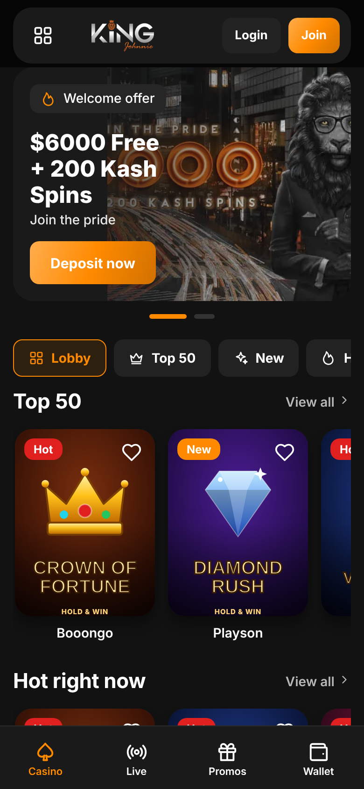
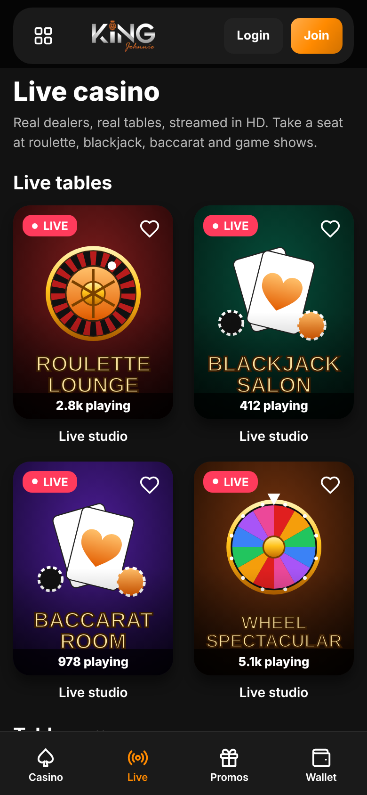
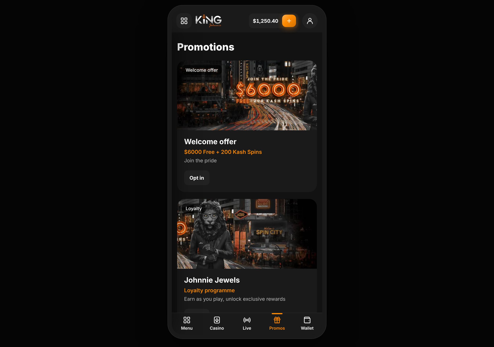
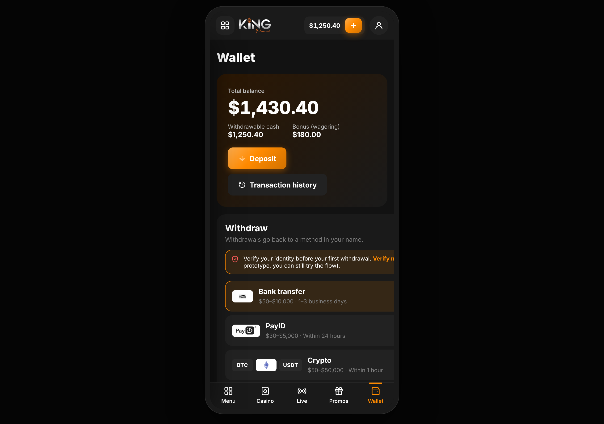
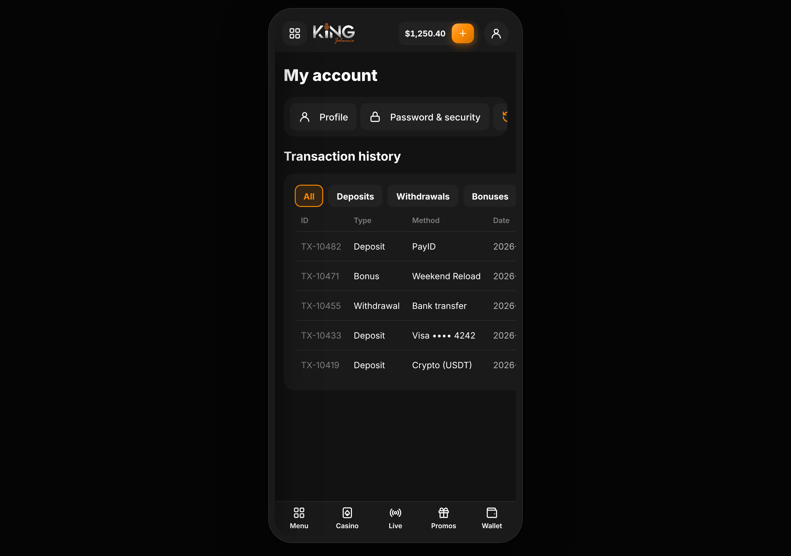
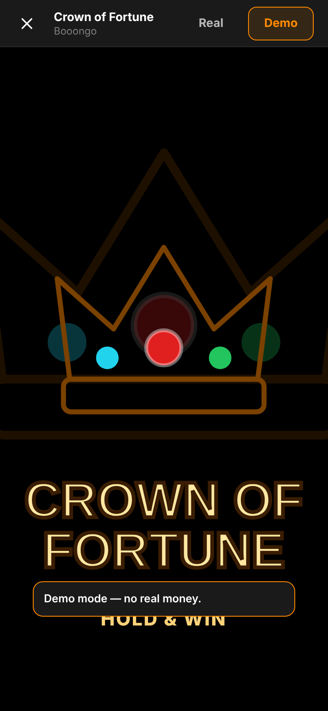

# 🎰 Gold Group — Casino Sites, Recreated

This repository is where the Gold Group casino brands are rebuilt in **React Native (Expo)** — one app per brand, sharing a common approach: a tokenised theme engine, a reusable component kit, parametric SVG game art, and a **swappable backend connector layer** so each app is plug‑and‑play against the live platform.

## Brands

| Brand | Status | Folder | Branch |
| --- | --- | --- | --- |
| 👑 **King Johnnie** | ✅ First build complete | [`king-johnnie/`](king-johnnie/) | `KingJohnnie` |
| _…more to come_ | 🔜 | | |

## 👑 King Johnnie

A mobile-first recreation of [kingjohnnie.ai](https://www.kingjohnnie.ai/en) — every page, element and function accounted for: casino lobby, live casino, promotions, wallet (deposit/withdraw), full account area, game launcher, auth, contact and info pages.

<p align="center">
  
  
  
</p>
<p align="center">
  
  
  
</p>

**→ Full documentation, architecture and setup: [`king-johnnie/README.md`](king-johnnie/README.md)**

### Quick start

```bash
cd king-johnnie
npm install
npm start      # press i / a / w for iOS / Android / web
```

Runs fully offline on bundled demo data out of the box. Point it at a live
backend by setting `EXPO_PUBLIC_DATA_SOURCE=live` and your API URL — no UI
changes required. See the app README for the connector contract.

## Shared conventions (for new brands)

- **Expo Router** file-based navigation, TypeScript strict mode.
- **`src/theme`** — design tokens + runtime brand-colour swapping.
- **`src/services`** — the `CasinoServices` contract (auth · wallet · games · content) with `mock` and `live` adapters chosen from config.
- **`src/components`** — brand-neutral UI kit (buttons, tiles, carousels, SVG icons & game art).
- **`docs/screenshots/`** — visual snips for the brand's README.

To add a brand: copy `king-johnnie/`, re-theme via tokens, repoint the `live`
adapters, and swap the assets.

---

<sub>🔞 These apps are UI recreations of 18+ real-money gambling brands. No gambling logic, odds, or real-money processing lives in this repository. Play responsibly.</sub>
