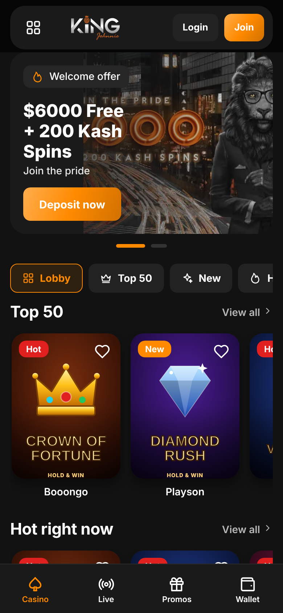
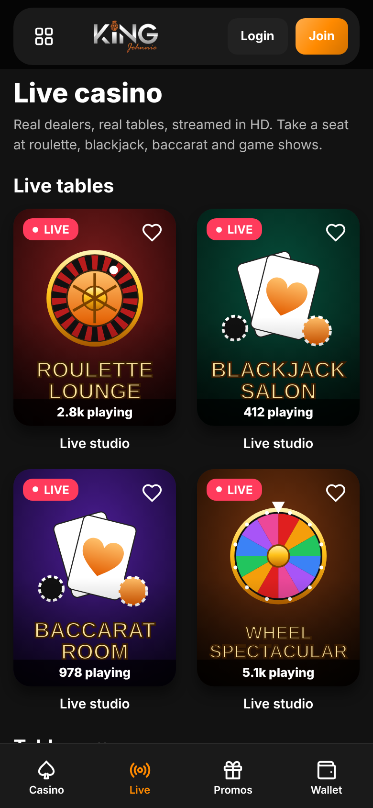
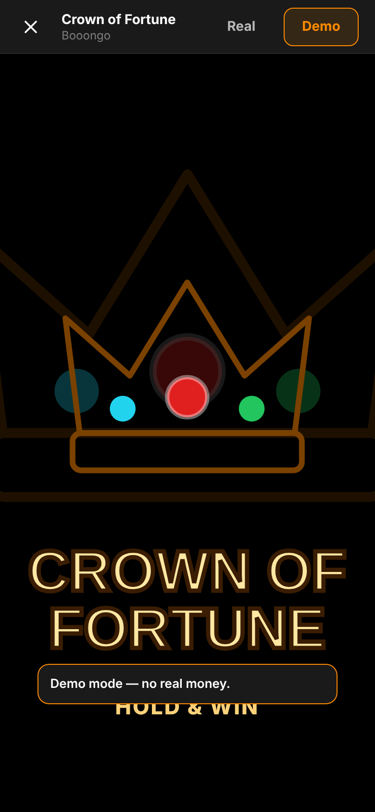
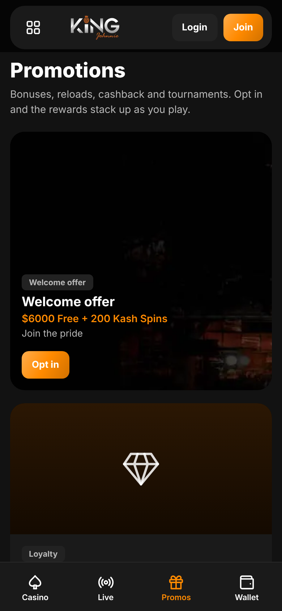
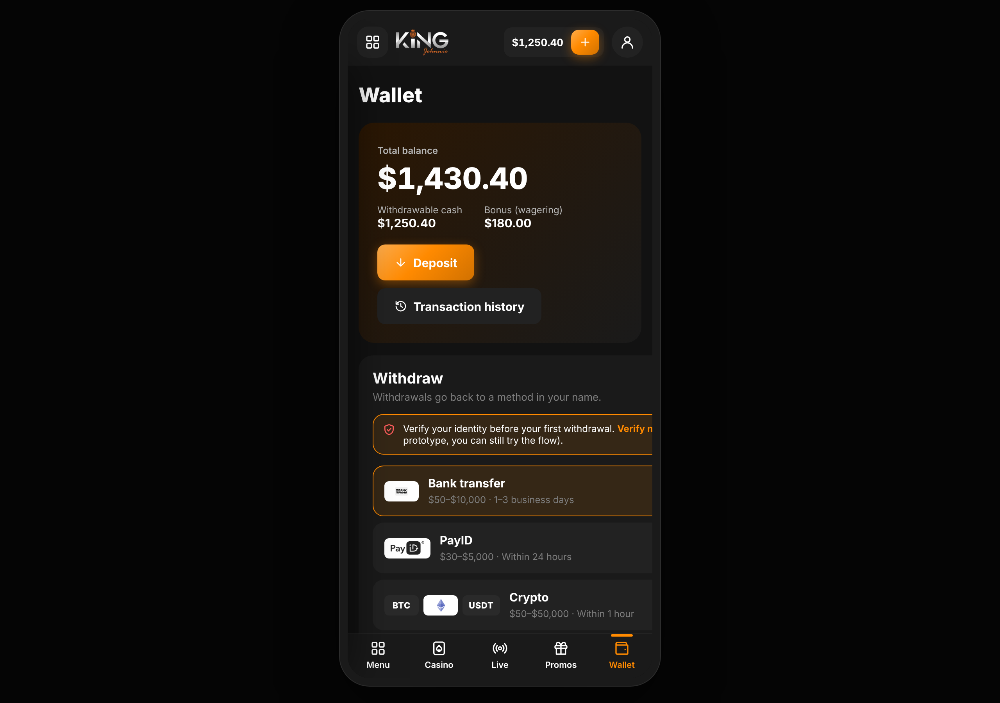
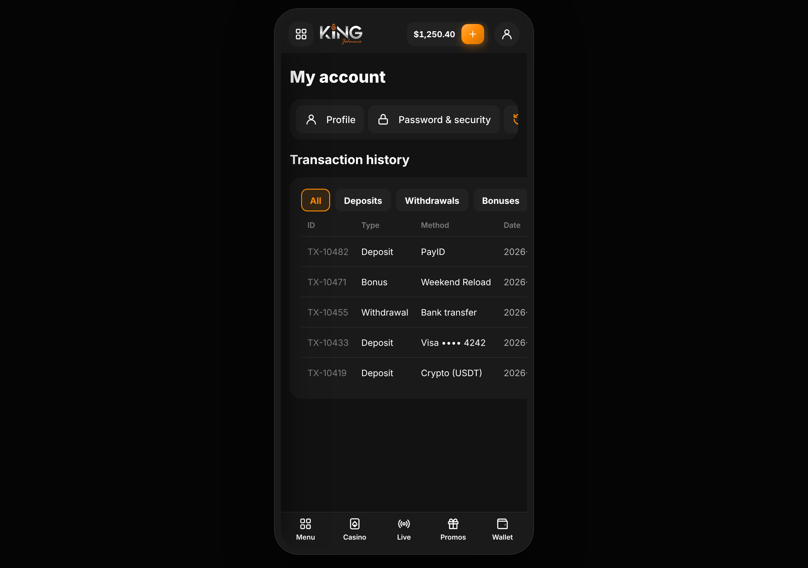
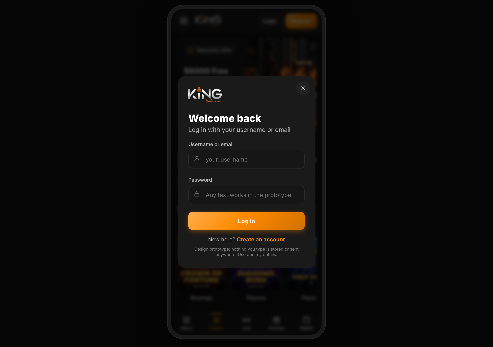
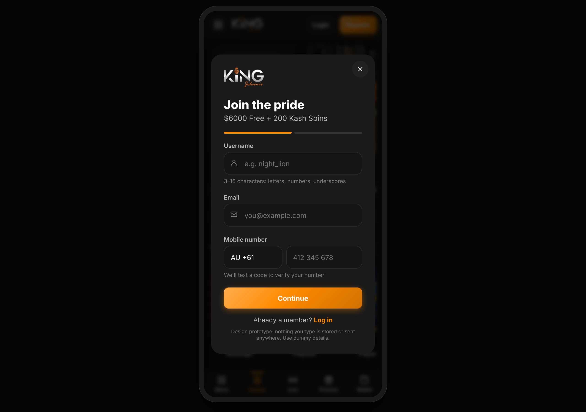
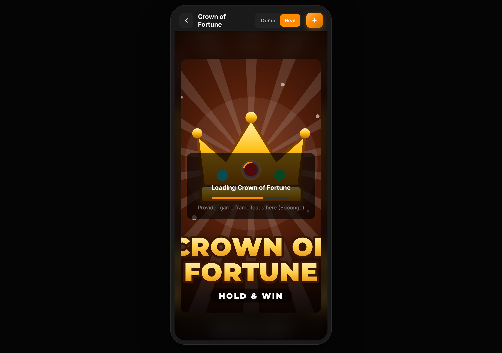

# 👑 King Johnnie — React Native (Expo)

A full, mobile-first rebuild of the **King Johnnie** online casino ([kingjohnnie.ai](https://www.kingjohnnie.ai/en)) in **React Native + Expo + TypeScript**, with smoother motion, reusable components and a **swappable backend connector layer** so it's plug‑and‑play against any casino platform.

> This is the first site in the **Gold Group** multi-brand recreation. The codebase is structured so additional brands can reuse the same component kit, theme engine and connector layer.

<p align="center">
  
  
  
</p>
<p align="center"><em>↑ Screens rendered from this React Native codebase (via the Expo web target).</em></p>

---

## ✨ What's included

Every page, element and function from the design prototype is accounted for:

| Area | Screen / route | Highlights |
| --- | --- | --- |
| **Casino lobby** | `app/(tabs)/index.tsx` | Hero carousel, 9 category tabs, game rails + grid, provider rail, favourites |
| **Live casino** | `app/(tabs)/live.tsx` | Live tables + table games, live player counts, `LIVE` badges |
| **Promotions** | `app/(tabs)/promos.tsx` | Welcome offer, loyalty, reloads, cashback, tournaments |
| **Wallet** | `app/(tabs)/wallet.tsx` | Balance hero, deposit + withdraw flows, methods, quick amounts, bonus opt‑in |
| **Deposit** | `app/deposit.tsx` | Focused deposit modal (shares the wallet form) |
| **Account** | `app/account.tsx` | 8 sub‑tabs: profile, security, transactions, bonuses, verification (KYC), responsible gaming, sessions, preferences |
| **Game launcher** | `app/game/[id].tsx` | Real / demo toggle, loader, ambient art, WebView embed for live games |
| **Auth** | `app/login.tsx`, `app/signup.tsx` | Login + 2‑step signup with live username check, country picker, T&C gate |
| **Menu** | `app/menu.tsx` | Full navigation drawer: categories, providers, account, info |
| **Contact** | `app/contact.tsx` | Live chat / email / phone channels |
| **Info pages** | `app/info/[slug].tsx` | Terms, Responsible Gaming, Privacy, About, FAQs, Banking, Promo T&Cs |

**Design system & motion**
- 🎨 Tokenised theme (`src/theme`) ported 1:1 from the brand palette, with a **runtime‑swappable brand colour** for re‑skinning other brands.
- 🃏 **32 games** across 6 providers, each with **parametric SVG cover art** — 20 reusable game-art motifs (crown, gem, roulette, wheel, cards…) drawn with `react-native-svg`. No bitmap game art needed.
- 🎛️ 41 line icons ported to `react-native-svg` in a single data-driven `<Icon />`.
- 💫 Micro-interactions with `react-native-reanimated` (press springs, tile lift, heart pop, toasts, carousel).

---

## 🏗️ Architecture

```
king-johnnie/
├─ app/                      # Expo Router routes (file-based navigation)
│  ├─ _layout.tsx            # Providers + root stack (modals: login, signup, deposit, game)
│  ├─ (tabs)/                # Bottom tab bar: Casino · Live · Promos · Wallet
│  ├─ account.tsx  contact.tsx  menu.tsx
│  ├─ game/[id].tsx          # Full-screen game launcher
│  └─ info/[slug].tsx        # CMS-style info pages
├─ src/
│  ├─ theme/                 # tokens.ts · ThemeProvider.tsx (brand-swappable)
│  ├─ data/                  # games, providers, promos, methods, countries, info, account
│  ├─ services/              # 🔌 CONNECTOR LAYER (see below)
│  ├─ store/                 # Auth, Favorites context providers
│  ├─ components/            # Button, GameTile, HeroCarousel, PromoCard, Icon, art/…, wallet/…
│  └─ utils/                 # money, luhn, formatting
├─ assets/images/            # logo, hero, payment logos
└─ docs/screenshots/         # the snips in this README
```

### 🔌 The connector layer (plug‑and‑play)

Every screen talks to **one interface** — `services` — and never knows whether the data is live or mocked. That decision is made once, from config:

```
src/services/
├─ types.ts     # CasinoServices: auth · wallet · games · content  (the contract)
├─ config.ts    # reads EXPO_PUBLIC_* env (data source + API base URLs)
├─ http.ts      # fetch wrapper (bearer token, JSON, errors)
├─ mock.ts      # offline adapters backed by bundled demo data  ← default
├─ live.ts      # REST adapters (map the contract onto your endpoints)
└─ index.ts     # factory: picks mock ↔ live from config
```

To go live, set two env vars and point the `live.ts` paths at your platform
(SoftSwiss, EveryMatrix, Pragmatic, or a bespoke API):

```bash
EXPO_PUBLIC_DATA_SOURCE=live
EXPO_PUBLIC_API_BASE_URL=https://api.yourcasino.com
```

No screen changes required. Game launch URLs, the support‑chat widget and
analytics keys are configured the same way (see `.env.example`).

The contract covers:

- **auth** — `login`, `signup`, `logout`, `restore`, `isUsernameTaken`
- **wallet** — `getBalance`, `deposit`, `withdraw`, `depositMethods`, `withdrawMethods`, `transactions`, `bonuses`
- **games** — `list`, `byCategory`, `search`, `launch(mode)`
- **content** — `promotions`, `infoPage`

---

## 🚀 Getting started

```bash
cd king-johnnie
npm install
cp .env.example .env     # optional — defaults to offline mock data
npm start                # then press i (iOS), a (Android), or w (web)
```

Scripts:

| Command | What it does |
| --- | --- |
| `npm start` | Start the Expo dev server |
| `npm run ios` / `android` / `web` | Open on a platform |
| `npm run typecheck` | `tsc --noEmit` (passes clean ✅) |
| `npm run lint` | ESLint (expo config) |

**Requirements:** Node 18+, the [Expo](https://docs.expo.dev/) toolchain, and Xcode / Android Studio for native builds (or just a phone with **Expo Go**).

---

## 🖼️ More screens

<p align="center">
  
  
  
</p>
<p align="center">
  
  
  
</p>

> `rn-*` images are rendered from this React Native build; the remaining phone
> frames are from the approved design prototype and match the shipped screens.

---

## 🧱 Tech stack

- **Expo SDK 52** · React Native 0.76 · React 18
- **Expo Router v4** (file-based navigation, typed routes)
- **react-native-reanimated** (animations) · **react-native-gesture-handler**
- **react-native-svg** (icons + all game art) · **expo-linear-gradient**
- **react-native-webview** (live game embedding)
- **TypeScript**, strict mode

---

## 🔭 Roadmap / integration notes

- Wire `src/services/live.ts` to the production casino API and aggregator.
- Persist the auth token with `expo-secure-store` in `AuthService.restore()`.
- Drop in brand fonts (Jost / Montserrat / Inter) via `expo-font` and point `typography.family` at them.
- Add localisation (12 markets already modelled in `src/data/catalog.ts`).
- Hook the support channel up to your live-chat provider via `EXPO_PUBLIC_SUPPORT_CHAT_URL`.

---

<sub>🔞 King Johnnie is an 18+ real-money gambling brand. This repository contains UI only — no gambling logic, odds, or real-money processing. Always gamble responsibly.</sub>
